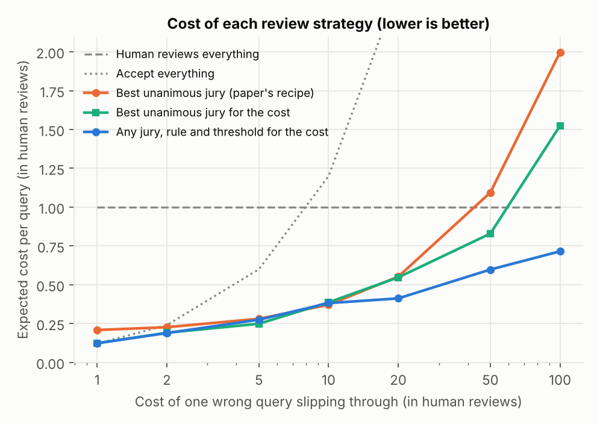
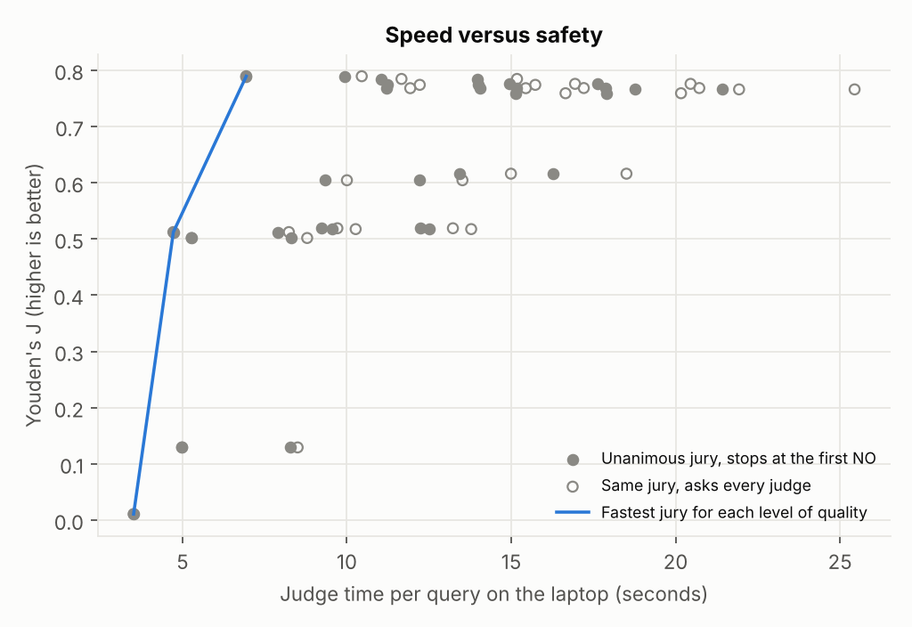
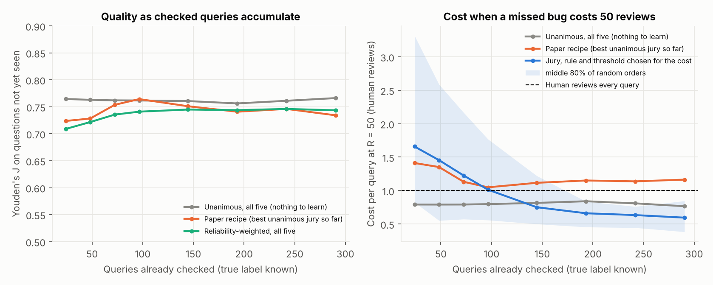

# LLM juries for AI-written SQL: a pilot study

A small, fully reproducible pilot, run on one laptop, that follows up on

> M. A. Ullah and A. Serwadda, **"Vibe Coding on Trial: Operating Characteristics of Unanimous LLM Juries,"**
> 2026 International Conference on Semantic Computing (ICSC), pp. 230–237. [arXiv:2602.18492](https://arxiv.org/abs/2602.18492)

That paper asks AI models to act as a jury over AI-written SQL and accepts a query only if **every** judge says it is correct. Its conclusion names, as future work, "exploring adaptive or weighted committees learned from per-judge calibration" and "integrating cost/risk trade-offs to select panels and thresholds automatically". This repository builds a small version of both, and then tests several other questions the paper raises but leaves open.

## The question

> If each judge's vote counts according to how reliable that judge has proven to be, can a jury block as many wrong queries as an "everyone must agree" jury while passing more correct ones? And can the jury and its strictness be chosen automatically for a given cost of letting a bad query through?

**Why it matters.** Reading the paper's committee figures, juries that include one particular judge (codellama:34b) pass roughly 70% of correct queries, while juries without it pass about 95% or more. On its own, that judge passes correct and wrong queries at almost the same rate. A unanimous vote gives every judge a full veto, so a judge that vetoes almost at random costs many good queries for little safety. A weighted vote can give such a judge almost no say, without anyone having to pick the right committee by hand.

## What this pilot adds

| | Original study | This pilot |
|---|---|---|
| Queries reviewed | model-written SQL for 82 questions (492 queries from 6 models) | model-written SQL for 82 questions (**397 queries, 93 wrong**) plus **273 planted-bug queries** (182 wrong), all labeled by execution |
| Judge output | correct / incorrect | correct / incorrect **plus stated confidence** |
| Ways to combine votes | unanimous | unanimous, majority, **reliability-weighted**, **confidence-weighted (recalibrated)**, **Dawid-Skene (no labels needed)** |
| Choosing the jury | exhaustive sweep, inspected by hand | **automatic choice by cost of a false accept**, cross-validated |
| Uncertainty | none reported | 5-fold cross-validation grouped by task, **95% bootstrap intervals over tasks** |
| Extra analyses | aggregate and per-generator | **veto effect of each judge**, **writer × judge table**, **per-writer (adaptive) weights**, **planted vs real mistakes**, strict and lenient labels |
| Questions the paper raises but leaves open | named in the text | **tested**: shared blind spots and majority voting, why self-judging is optimistic, per-writer and writer-excluded juries out of sample, harder questions, speed, a jury that learns over time, a hand audit of every "wrong" label |

## Results

Five local judges (codegemma:7b, codellama:13b, gemma3:12b, phi4:14b, gpt-oss:20b), each run once at temperature 0 on a laptop. They reviewed two sets of queries:

* **Model-written queries** (the main set, like the paper's): the same five models wrote SQL for all 82 questions. Of 410 answers, 13 did not run and were left out, leaving **397 queries: 304 correct and 93 wrong** (strict label, the paper's rule). Results in `results/natural/` and, with the lenient label, `results/natural_lenient/`.
* **Planted bugs**: 273 queries (91 correct, 182 wrong) over the first 40 questions. Results in `results/planted/`.

All 3,350 votes are in `results/votes.jsonl`, so every number below can be rebuilt in about a minute with `scripts/run_all.ps1` (or `scripts/run_all.sh`), with no models needed. Intervals are 95% bootstrap over questions; everything tuned is tuned on other questions (5-fold).

**In short**

1. Weighting the judges' votes ties the paper's unanimous recipe; it does not beat it (section 1).
2. Choosing the jury and a strictness threshold for the cost of a missed bug makes review much cheaper when mistakes are expensive, about half the paper recipe's cost at R = 50 (section 2), but it needs on the order of a hundred checked queries to learn (section 12).
3. Planted bugs make judges look safer than they are: the best judge passes 3% of planted bugs but 16% of real mistakes (section 3).
4. Judges share blind spots: a unanimous jury of all five passes 3.4 times more wrong queries than independent judges would (section 7). Majority voting is far worse.
5. Self-judging is optimistic, but mostly because a model that misreads a question passes anyone's wrong answer to it, not because it favours its own SQL; so keeping the writer off its jury does not help (sections 8 and 9).
6. About 1 in 9 execution-labeled mistakes is not a real mistake, and counting them as correct changes none of the conclusions (section 13).

### 1. Weighted voting ties the paper's unanimous recipe; it does not beat it

| Model-written queries, strict label | Passes correct | Passes wrong | Youden's J | Difference in J vs paper recipe |
|---|---|---|---|---|
| Paper recipe: best unanimous jury, chosen on training questions | 91% | 15% | 0.76 | |
| Unanimous, all five judges | 85% | 9% | 0.77 | +0.2 points [−6.3, +8.6] |
| Reliability-weighted vote, all five | 89% | 13% | 0.76 | −0.5 points [−4.3, +3.6] |
| Confidence-weighted vote, all five | 88% | 14% | 0.74 | −2.5 points [−7.4, +2.2] |
| Dawid-Skene (no labels at all) | 93% | 31% | 0.62 | −14.5 points [−29.3, −2.1] |

With the lenient label the picture is the same (weighted +0.8 points [−0.9, +3.8]). On planted bugs, too, weighting ties the recipe (−1.6 points [−4.5, 0.0]).

**Why.** One judge, gpt-oss:20b, does most of the work: added to a unanimous jury it blocks, on average, 73% of the wrong queries that got past the others, at a cost of 4% of correct ones. Every good jury is "gpt-oss plus helpers", and a weighted vote mostly learns to follow gpt-oss too. Weighting was meant to fix judges whose veto is close to random, like codellama:34b in the paper. The smaller codellama:13b used here behaves differently: it passes almost everything (83% of wrong queries), so its veto is rare and does little harm. With no harmful veto in the panel, there was little for weighting to fix.

Per committee, the confidence-weighted vote has a higher J than the unanimous vote in 21 of 26 committees. The gain is larger for committees without gpt-oss (about +6 points on average, against +1 with it), but it is clearly above zero for only one or three committees, depending on the label, so this is a hint, not a finding.

### 2. Choosing the jury and its strictness by cost helps when mistakes are expensive

R is the cost of one wrong query slipping through, counted in human reviews. For each R, the jury, the voting rule and the threshold are chosen on training questions to keep expected cost lowest, then applied to held-out questions. The share of wrong queries arriving is assumed to be 12%. Two baselines: the paper recipe (best unanimous jury by J), and a fairer one that keeps the paper's unanimous rule but also picks the jury by cost (or sends everything to a human, if that is cheaper).

| R | Any jury, rule and threshold, chosen by cost | Paper recipe | Difference [95% interval] | Unanimous jury chosen by cost | Difference [95% interval] |
|---|---|---|---|---|---|
| 1 | 0.12 | 0.21 | −0.09 [−0.13, −0.05] | 0.12 | 0.00 [0.00, 0.00] |
| 2 | 0.19 | 0.23 | −0.04 [−0.08, 0.00] | 0.19 | 0.00 [−0.02, +0.02] |
| 5 | 0.28 | 0.28 | −0.01 [−0.04, +0.03] | 0.25 | +0.03 [−0.01, +0.07] |
| 10 | 0.38 | 0.37 | +0.01 [−0.02, +0.04] | 0.39 | 0.00 [−0.03, +0.01] |
| 20 | 0.41 | 0.55 | −0.14 [−0.32, +0.01] | 0.55 | −0.14 [−0.31, 0.00] |
| 50 | 0.60 | 1.09 | −0.50 [−0.96, −0.11] | 0.83 | −0.23 [−0.48, −0.01] |
| 100 | 0.72 | 2.00 | −1.28 [−2.20, −0.49] | 1.52 | −0.81 [−1.25, −0.43] |

(Cost per query in human reviews; a human reviewing every query costs 1.00. Model-written queries, strict label; the full table is in `results/natural/summary.md`.)



At R = 1 the cheapest plan is to pass almost everything; both cost-based choices find it, while the fixed recipe rejects more than it needs to. From R = 2 to 10 the three are close. From R = 20 on they split (at R = 20 the intervals still just touch zero). At R = 50 the paper recipe costs **more than having a human review every query** (1.09), because a jury that passes 15% of wrong queries is too lenient once mistakes are expensive. A unanimous jury can only get stricter by adding judges, and even all five together still pass 9% of wrong queries. The automatic choice instead usually picks a confidence-weighted vote of gemma3, gpt-oss and phi4 with a strict threshold. At R = 50 it costs 0.60: 45% less than the paper recipe and 28% less than the best unanimous jury chosen for the cost.

This holds with the lenient label (R = 50: −0.31 [−0.60, −0.05] against the fairer baseline) and when the assumed share of wrong queries is 5% (R = 100: −0.21 [−0.42, −0.02]) or 25% (R = 50: −0.69 [−1.13, −0.30]); these two checks are rebuilt with `--wrong-share 0.05` or `--wrong-share 0.25`. One exception: with 25% wrong queries and R = 100, a human reviewing everything is cheapest, and the automatic choice (1.14) does not beat it.

On planted bugs, which these judges catch easily, there is no consistent saving: small gains at some R, small losses at others. So the benefit shows up exactly when judges miss real mistakes. What helps is not a cleverer way of adding up votes, but a strictness dial, which a unanimous vote does not have.

### 3. Planted bugs make judges look much better than they are

| Share of wrong queries each judge passed | Planted bugs | Model-written mistakes |
|---|---|---|
| gpt-oss:20b | 3% | 16% |
| phi4:14b | 21% | 45% |
| gemma3:12b | 24% | 42% |
| codellama:13b | 58% | 83% |
| codegemma:7b | 90% | 99% |

Every judge lets through more real mistakes than planted ones, and the best judge five times as many. Benchmarks built from single, local mutations overstate how safe a jury is.

### 4. The better the writer, the harder its mistakes are to catch

Share of each writer's wrong queries that each judge passed (diagonal in bold: a model judging its own SQL):

| Writer (wrong queries) | codegemma | codellama | gemma3 | gpt-oss | phi4 |
|---|---|---|---|---|---|
| codegemma:7b (21) | **100%** | 86% | 43% | 19% | 43% |
| codellama:13b (30) | 97% | **87%** | 23% | 7% | 23% |
| gemma3:12b (17) | 100% | 76% | **41%** | 0% | 47% |
| gpt-oss:20b (10) | 100% | 80% | 80% | **50%** | 80% |
| phi4:14b (15) | 100% | 80% | 53% | 27% | **67%** |

gpt-oss makes the fewest mistakes, but the ones it makes slip past everyone, itself included. Read on its own, this table cannot tell whether a judge is easier on its own SQL, because each writer's mistakes differ in difficulty; section 8 tests that properly.

### 5. Weights learned separately per writer model did worse

Weights fitted only on queries from the same writer (falling back to shared weights when a writer had fewer than 5 wrong or 5 correct training queries) lowered J by 4.4 points [−9.4, −0.1] (strict) and 3.5 points [−8.3, +0.5] (lenient) compared with shared weights. With this little data per writer, splitting adds more noise than it removes. Adaptive weighting needs far more queries per writer than a laptop pilot can produce.

### 6. What even the best judge misses

Of the 15 wrong queries that gpt-oss:20b passed, 9 are real mistakes by the reading in section 13. The other 6 are not: two return an extra column, two answer an ambiguous original question (J3, where "items sold" can mean items in all orders or only in shipped or completed ones), one lists a name twice, and one puts the two names of a pair in the wrong order. The 9 real ones are subtle:

* integer division in SQLite, so a percentage always comes out as 0;
* a correlated subquery whose inner table hides the outer one, so each user is compared with the overall average (twice);
* a filter placed at the wrong point in a chain of LEFT JOINs (twice);
* a join that multiplies rows before averaging;
* "never reviewed by any of the users who ordered it" answered as "not reviewed by at least one of them";
* a user's second order on one day skipping the first when finding the "previous order";
* a percentage computed from the wrong count.

## Follow-ups: questions the paper raises

Each analysis below answers a sentence in the paper, quoted with its section. None needs new model runs: they reuse the saved votes. Code: `wjury/followups.py` (sections 7 to 12) and `data/audit_wrong_queries.csv` (13). Results: `results/natural/followups/followups.md`. All use the strict label unless stated; intervals are 95% bootstrap over questions.

### 7. Judges share blind spots, so unanimity protects less than it seems

> "errors across judges can be correlated (and simple majorities can amplify a shared bias)" (Section I)

| Jury (unanimous) | Wrong queries passed | Expected if judges erred independently | Ratio [95% interval] |
|---|---|---|---|
| All five | 9% | 2.5% | 3.4× [1.6, 6.7] |
| gemma3 + gpt-oss + phi4 | 9% | 3.1% | 2.8× [1.3, 5.4] |
| gpt-oss + phi4 | 14% | 7.3% | 1.9× [1.4, 2.6] |

When gpt-oss is fooled, phi4 is fooled 87% of the time (45% usually) and gemma3 67% (42% usually). Adding judges helps less than independence would promise, because the hard queries fool most of them at once.

Majority voting, which the paper names but does not test, is much worse here: a 3-of-5 majority passes 57% of wrong queries, and a 2-of-3 majority of the three best judges passes 37% (J 15 points below the paper recipe [−29, −3]). Among the three best judges, the majority passes 1.4× [1.1, 1.7] as many wrong queries as independence predicts: a shared bias, amplified. This supports the paper's choice of unanimity.

### 8. Judges miss mistakes on questions they themselves get wrong

> "self-judging may introduce optimism or style bias" (Section III-C)

A two-way fixed-effects model removes how hard each query is and how lenient each judge is, then asks how much more often a judge passes a wrong query when:

| | Extra chance of passing a wrong query [95% interval] |
|---|---|
| the judge wrote this query | +22 points [+12, +32] |
| the judge did not write it, but got the same question wrong itself | +18 points [+6, +30] |
| difference: its own text, beyond the shared misunderstanding | +4 points [−5, +13] |

So self-judging is optimistic, as the paper suspected, but mostly not because a model likes its own text. A model that misunderstands a question passes wrong answers to that question from anyone, its own included. On correct queries there is no effect either way. The same holds with the audited labels of section 13 (+22, +15, +7 points).

### 9. Per-writer juries, and keeping the writer off its own jury

> "This argues for per-generator validation" ... "deployments should test both inclusive (with self-judging) and exclusive configurations" (Section V)

The paper picks committees on the same queries it reports. Here they are chosen on training questions and scored on held-out ones:

| Comparison | J difference [95% interval] |
|---|---|
| Jury chosen per writer vs one shared jury | +4.1 points [−1.4, +9.8] (audited labels: +3.4 [+0.3, +7.6]) |
| Writer kept off its own jury vs allowed (shared choice) | −1.4 points [−6.5, +3.6] |
| Writer kept off its own jury vs allowed (per-writer choice) | −5.9 points [−10.2, −1.9] |

Choosing a jury per writer helps a little (clearly so only with the audited labels). Keeping the writer off its own jury does not help and can hurt: for gpt-oss's queries it removes the best judge (J 0.66 → 0.22). Together with section 8, the lesson is that excluding the writer does not remove the bias, because the other judges who misread the question share it.

### 10. Harder questions

> future work: "adding harder compositional queries" (Section V)

| Questions | Answers that ran | Wrong | Wrong passed by the paper recipe |
|---|---|---|---|
| Original 40 | 198 | 11 (6%) | 27% |
| Harder 42 | 199 | 82 (41%) | 13% |

The harder questions make writers fail far more often (+36 points [+25, +46]). Whether juries catch those mistakes better or worse cannot be told: with only 11 wrong queries on the original questions, the interval runs from −61 to +17 points.

### 11. Speed versus safety

> "we do not optimize for latency or cost" (Section V)

* A unanimous jury can stop at the first INCORRECT: same decisions, less time. With the judge order chosen on training questions, this saves 9% of judge time on average (2% to 16%), little because most queries are correct and must go through every judge.
* By Youden's J, no unanimous jury beats gpt-oss alone (J 0.79, 6.9 seconds per query on the laptop). Juries only pay off when fewer false accepts are needed: the fastest jury passing at most 10% of wrong queries is gemma3 + gpt-oss + phi4 (86% of correct queries passed, 14.9 s per query).



### 12. A jury that learns as checked queries arrive

> future work: "adaptive or weighted committees learned from per-judge calibration" (Section V)

Questions arrive in random order (40 orders). After each batch, every method is refitted on the queries checked so far and scored on the questions not yet seen.



* Quality (J): no learning method ever beats the fixed unanimous jury of all five. Weighting gains nothing even with 290 checked queries.
* Cost at R = 50: with fewer than about 100 checked queries, learning the jury and threshold is worse than the paper recipe, because there are too few wrong examples to set a strict threshold. After about 100 it is cheaper than the recipe, after about 150 cheaper than the fixed all-five jury, and with 290 it costs 0.60 against 1.16 for the recipe. So a cost-tuned jury needs on the order of a hundred or more checked queries, a real-world cost of this approach.

### 13. How many "wrong" queries are really wrong?

> "an execution-based label that, while reproducible, abstracts away human intent nuances" (Section V)

Each of the 93 wrong queries was read next to its question and the difference in results, and given one category (`data/audit_wrong_queries.csv`, with a reason for each):

| Category | Queries |
|---|---|
| Real mistake | 83 |
| Right rows plus extra columns | 4 |
| Answers an ambiguous question in a reasonable way | 2 |
| Right content, but ignores a formatting rule the question gave (pair order, "show each once") | 3 |
| Right content, one row repeated (the question does not ask for unique rows) | 1 |

So about 1 in 9 execution-labeled "mistakes" would not bother the person who asked. They come from three writers: codegemma (5 of its 21 wrong queries), phi4 (3 of 15) and gpt-oss (2 of 10). With these 10 counted as correct (`--label audited`, results in `results/natural_audited/`), every conclusion above stays the same: weighting still ties the recipe (−0.7 points [−5.1, +3.3]), and the cost-tuned jury still beats the recipe at R = 50 (0.44 against 0.84, difference −0.40 [−0.84, −0.04]). This is one reader's judgment and has not been checked by a second person.

## How it works

```
 82 questions (40 original + 42 harder)     10 seeded SQLite shop databases
            │                                          │
            ▼                                          ▼
 SQL written by the 5 models ─────────┐     execution check on all 10 databases
 reference SQL ──► rewrites, bugs ────┤     (a candidate is correct only if its results
   (first 40 questions only)          └──►   match the reference on every database)
                                                       │
            397 model-written queries (93 wrong) + 273 planted (182 wrong)
                                                       │
                                                       ▼
                         judges (local Ollama models or any OpenAI-compatible API)
                         return CORRECT / INCORRECT and a confidence from 0 to 100
                                                       │
                                                       ▼
                 unanimous · majority · weighted · confidence-weighted · Dawid-Skene
                 · automatic jury choice by cost, all tuned on other tasks
                                                       │
                                                       ▼
                    tables, figures and a summary.md for each set of queries
```

**Databases** (`wjury/db.py`). The same six-table online store as the paper (Users, Categories, Products, Orders, Order_Items, Reviews). The generator deliberately plants the data that subtle bugs trip over: an empty category, products nobody ordered, users with no orders, missing ages and locations, the same product twice in one order, and two orders by one user on the same day.

**Questions** (`wjury/tasks.py`, `wjury/hard_tasks.py`). Forty questions, eight per tier: basic retrieval, aggregates, joins and grouping, HAVING filters, subqueries and window functions. Each has a reference query, and most have a differently written correct version. Forty-two harder questions were added for the model-written set, so that the total matches the paper's 82. Each was written around a known SQL trap (NULL inside `NOT IN`, join fan-out, integer division, ties, empty groups, "for all" conditions) and worded to have one clear reading; the trap is used only to confirm the question can catch it and is never shown to any model.

**Planted bugs** (`wjury/mutate.py`, `wjury/build_candidates.py`). Each correct query is changed in exactly one place, the way a model or a person slips: `>` for `>=`, a missing DISTINCT, INNER JOIN where LEFT JOIN was needed, joining on the wrong id column, `'complete'` for `'completed'`, `= NULL`, COUNT instead of SUM, AND instead of OR, a dropped condition, and a few hand-written bugs (a window frame without a tie-breaker, a correlated subquery made uncorrelated). A change is kept only if execution proves it gives different results on at least one database; 35 changes that happened to give identical results were discarded, because their true label is ambiguous. Every candidate, correct or wrong, is printed by the same SQL formatter, so formatting never gives away the label.

**Judges** (`wjury/judges.py`). Each judge sees the question, the schema and the candidate query, as in the paper, and is asked for a verdict and a confidence. Every answer is saved as soon as it arrives, so an interrupted run resumes where it stopped.

**Combining votes** (`wjury/aggregate.py`).
* *Reliability-weighted.* A CORRECT vote from judge *j* adds log(TPRⱼ/FPRⱼ) and an INCORRECT vote adds log((1−TPRⱼ)/(1−FPRⱼ)), with each judge's true and false accept rates measured on training tasks. A judge that passes good and bad queries equally often gets a weight near zero.
* *Confidence-weighted.* Each judge's stated confidence is first recalibrated on training tasks (Platt scaling), because models tend to say "95% sure" about everything, and the calibrated log-odds are then added.
* *Dawid-Skene* (1979). Learns each judge's reliability from the votes alone, with no labeled queries. It needs at least three informative judges whose mistakes are not too correlated.
* *Automatic choice by cost.* Cost per incoming query, measured in human reviews: R × P(wrong query accepted) + P(query rejected and sent to a human) + a small charge per second of judge time. For each R, the jury, rule and threshold with the lowest cost on training tasks are applied to held-out tasks. A realistic share of incoming wrong queries (12% by default) is assumed rather than the test set's mix.

**Fair testing** (`wjury/analyze.py`). Anything that is learned (weights, calibration, thresholds, which jury to use) is learned on four fifths of the tasks and evaluated on the remaining fifth, rotating five times. Intervals resample whole tasks, because queries from the same question are related.

## Run it

You need Python 3.10 or newer. The judges can be local models through [Ollama](https://ollama.com) or any OpenAI-compatible API.

### Windows (PowerShell)

```powershell
git clone https://github.com/abdullazada-mustafa/llm-jury-sql.git
cd llm-jury-sql
python -m venv .venv
Set-ExecutionPolicy -Scope Process -ExecutionPolicy Bypass   # lets this window run the scripts below
.\.venv\Scripts\Activate.ps1
pip install -r requirements.txt
python -m pytest -q                      # 28 tests, about 10 seconds

# Install Ollama for Windows, then download the judges. Three are the paper's own
# (codegemma:7b, phi4:14b, gpt-oss:20b); two are smaller versions of its
# gemma3:27b and codellama:34b so that they fit on a laptop.
ollama pull codegemma:7b
ollama pull phi4:14b
ollama pull gemma3:12b
ollama pull codellama:13b
ollama pull gpt-oss:20b                  # needs about 16 GB of memory

# Speed test on 3 questions; the printout shows the time per query
python -m wjury.judges --models codegemma:7b --tasks B1,A4,S7 --out results/speedtest.jsonl

# Rebuild every table and figure from the committed votes (about a minute)
.\scripts\run_all.ps1
# To redo the whole study instead, first delete results\votes.jsonl, results\generated_raw.jsonl
# and data\generated.jsonl
# (several hours to a few days on a laptop without a GPU; safe to stop and rerun)
```

### macOS or Linux

```bash
python3 -m venv .venv && source .venv/bin/activate
pip install -r requirements.txt
python -m pytest -q
bash scripts/run_all.sh
```

### Using an API instead of local models

Any OpenAI-compatible endpoint works (OpenRouter, Groq, Together, a vLLM or LM Studio server):

```bash
export OPENROUTER_API_KEY=...            # PowerShell:  $env:OPENROUTER_API_KEY="..."
python -m wjury.judges --backend openai --base-url https://openrouter.ai/api/v1 \
       --api-key-env OPENROUTER_API_KEY --models openai/gpt-oss-120b --workers 4
```

Votes from local and API judges can be mixed in the same `results/votes.jsonl`.

### Model-written queries (natural mistakes, as in the paper)

The judges also review SQL written by the models themselves, over all 82 questions (as many as the paper): the original 40 plus 42 harder ones in `wjury/hard_tasks.py` (NULLs inside `NOT IN`, join fan-out, integer division, ties, empty groups, "for all" conditions). Each model answers each question once; every answer is labeled by execution. A second, *lenient* label also accepts answers whose only difference is extra or reordered columns, since the strict rule (the paper's) counts those as wrong.

```bash
python -m wjury.generate --models codegemma:7b,gemma3:12b,codellama:13b,phi4:14b
python -m wjury.generate --models gpt-oss:20b --think low
python -m wjury.judges   --models codegemma:7b,gemma3:12b,codellama:13b,phi4:14b --candidates data/generated.jsonl
python -m wjury.judges   --models gpt-oss:20b --no-json-mode --think low --candidates data/generated.jsonl
python -m wjury.analyze  --candidates data/generated.jsonl --out results/natural
python -m wjury.analyze  --candidates data/generated.jsonl --out results/natural_lenient --label lenient
```

`results/natural*/tables/wrong_queries_review.csv` lists every wrong query with each judge's verdict, for reading by hand. The committed `data/generated.jsonl` holds the queries that were judged; `generate` refuses to overwrite it, so the saved votes can never silently point at different queries.

### Main commands

| Command | What it does |
|---|---|
| `python -m wjury.build_candidates` | rebuilds `data/candidates.jsonl` (deterministic; already committed) |
| `python -m wjury.judges --models a,b,c` | collects verdicts into `results/votes.jsonl`, resumable |
| `python -m wjury.analyze` | writes `results/planted/summary.md`, `tables/*.csv` and `figures/*.png` (add `--candidates data/generated.jsonl --out results/natural` for the model-written set) |
| `python -m wjury.followups` | the follow-up analyses (sections 7 to 12) into `results/natural/followups/` |
| `python -m wjury.analyze --candidates data/generated.jsonl --label audited --out results/natural_audited` | main results with the hand-audited labels (section 13) |
| `python -m wjury.judges --backend sim --models sim-strong-a,sim-strong-b,sim-random-veto --out results_simulated/votes.jsonl` | fake judges for testing the pipeline only |

## Repository layout

```
wjury/db.py                 schema and seeded databases
wjury/execution.py          execution-grounded labeling (paper's protocol)
wjury/tasks.py              40 questions, reference queries, rewrites, hand-planted bugs
wjury/hard_tasks.py         42 harder questions for the model-written set
wjury/mutate.py             bug-planting and equivalence-preserving rewrites on the syntax tree
wjury/build_candidates.py   builds and labels the candidate set
wjury/judges.py             judge prompts, backends, resumable runner
wjury/generate.py           optional: models write SQL (natural mistakes)
wjury/aggregate.py          voting rules, Dawid-Skene, calibration, thresholds
wjury/analyze.py            cross-validated experiments, tables, summary
wjury/followups.py          follow-up analyses on questions the paper raises
wjury/figures.py            charts
wjury/simulate.py           simulated judges for testing only
data/candidates.jsonl       the 273 planted-bug candidates
data/generated.jsonl        the 397 model-written queries that were judged
data/audit_wrong_queries.csv  a category and reason for each of the 93 wrong ones
results/generated_raw.jsonl the models' full answers to all 82 questions, including the 13 that did not run
results/votes.jsonl         all 3,350 verdicts, with each judge's raw reply
results/natural/            main results (strict label), followups/ inside;
                            natural_lenient/, natural_audited/ and planted/ alongside
tests/                      unit and end-to-end tests
```

## Limitations

* **Small scale.** One schema, 82 questions, 93 wrong model-written queries (83 after the audit in section 13), five judges. The intervals are wide; a difference of a few points in J cannot be detected.
* **One strong judge.** gpt-oss:20b dominates this panel. A panel of judges with similar skill, or with a harmful random veto like the paper's codellama:34b, could give weighting more room. That is the most important thing to test next.
* **Smaller judges than the paper.** codellama:13b and gemma3:12b stand in for codellama:34b and gemma3:27b, and the 120B judge is missing. gpt-oss ran with low reasoning effort.
* **Prompt differs slightly.** Judges are also asked for a confidence from 0 to 100, which the paper did not ask for. This may change their verdicts a little.
* **The harder questions were written with known traps in mind.** That makes certain mistakes more common than in everyday use, and the mix of mistakes depends on my choice of traps.
* **Strict labels include some non-mistakes.** Extra columns, a repeated row, ignored formatting rules and one ambiguous original question (J3, "items sold") all count as wrong under the paper's rule. The lenient label handles the extra columns and the audited label all ten such queries (section 13); the conclusions do not change.
* **SQLite instead of the paper's MySQL.** SQLite is the database used by the standard text-to-SQL benchmarks (Spider, BIRD) and needs no server, so the study runs on any laptop with Python alone. One trap is specific to SQLite: dividing two whole numbers drops the fraction, where MySQL would keep it.
* **One run at temperature 0.** As in the paper, run-to-run variation is not measured.
* **Simple cost model.** One fixed cost per false accept and per human review, and an assumed share of wrong queries (12%; 5% and 25% checked).
* **Many comparisons.** The per-committee and per-writer tables involve many tests; single "clearly different" results there may be chance.
* **The audit of wrong queries is one reader's judgment.** It has not been checked by a second person; the reason for every decision is in the file so it can be checked.
* **The learning curve is a simulation.** It replays the saved votes in random orders and assumes each query's true label becomes known after it is checked.

## Related work

Weighting LLM judges by their reliability is not new in general. Balasubramanian et al., ["Dependence-Aware Label Aggregation for LLM-as-a-Judge via Ising Models"](https://arxiv.org/abs/2601.22336) (2026), compare weighted, Dawid-Skene and dependence-aware aggregation of binary judge votes, and Qian et al., ["Who can we trust? LLM-as-a-jury for Comparative Assessment"](https://arxiv.org/abs/2602.16610) (2026), learn a reliability for each judge in pairwise comparisons. Both study text tasks (relevance, toxicity, summaries, dialogue). This pilot applies the idea to the setting of Ullah and Serwadda: execution-grounded SQL correctness under a safety-first acceptance rule, with cost-aware selection of the jury and threshold.

## Acknowledgements

The study design follows Ullah and Serwadda (2026), and all credit for the original framework belongs to them. Dawid and Skene, "Maximum Likelihood Estimation of Observer Error-Rates Using the EM Algorithm," *Applied Statistics*, 1979.

## License

MIT. See `LICENSE`.
